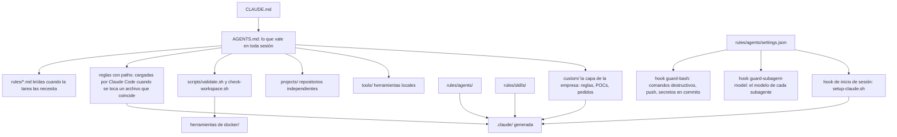

<!-- source: workspace/docs/overview.md sha256:75d5f6a5ce6b9832ebf9c5a5588c2a8c869a6cfee398b6f86823922383acdd5a -->

# Visión general

Claude CLI Agents Workspace guía a Claude Code en sesiones de desarrollo. La persona define **qué** hacer; Claude decide **cómo**. Uso diario: [usage.md](usage.md).

## Cómo se conectan las piezas

## Principios

| Principio | Cómo se nota |
| --- | --- |
| Libertad en el trabajo, rigor en el merge | El trabajo ocurre en un clon bajo `tmp/work/`, sin preguntas; el gate (`/merge`) es el único camino hacia `projects/`, con las verificaciones pesadas y las preguntas a la persona |
| Una sesión por pedido | La revisión es un subagente de contexto limpio dentro del gate; ninguna sesión espera a otra |
| Garantías en mecanismos | Lo que no debe ocurrir vive en un hook, un permiso o `aiwp-cmds.sh`, no en texto; el resto sigue el modo de permisos de Claude Code |
| Un registro por hecho | El commit registra el pedido; un registro de decisión solo para lo que es difícil de revertir |
| Reglas cortas | `AGENTS.md` cabe en una página; una regla por tema se carga solo cuando se toca un archivo de su tipo |

El diseño base y sus razones: [decisión 0001](../../../../workspace/docs/decisions/0001-base-design.md).

## Qué hace cada parte

- **`AGENTS.md`**: rol, entorno local, dónde ocurre el trabajo, la Definition of Done, seguridad y qué hacer cuando una regla estorba.
- **Reglas por path** (`quality`, `security`, `frontend`, `infra`, `docs`, `scripts`): llevan `paths:` al inicio; `setup-claude.sh` las copia a `.claude/rules/`, y Claude Code las carga cuando se lee o edita un archivo que coincide.
- **Reglas de referencia** (`git`, `review`, `models`, `rules`, `machine-load`): se leen cuando la tarea las necesita.
- **`scripts/aiwp-cmds.sh`**: el área de trabajo (clones bajo `tmp/work/`, push automático con escaneo de secretos, publicación en el Docker local con rollback) y el gate (`aiwp-gate.sh`: merge, release y apply de Terraform).
- **Hooks**: `guard-bash` (git en `projects/` y en el núcleo, Terraform, bases de datos, secretos en los commits de `custom/`), `guard-subagent-model` (el modelo de cada subagente), el hook `Stop` (commits que no están en el remoto) y el hook de inicio de sesión, que mantiene `.claude/` actualizada. Las reglas `deny` mantienen el núcleo y `projects/` de solo lectura.
- **Validación**: `scripts/validate.sh` ejecuta las herramientas de `docker/compose.yaml`; `scripts/check-workspace.sh` es el gate del repositorio del producto.
- **Subagentes**: once, con un modelo fijo por rol (`rules/models.md`). Por defecto trabaja un solo agente; `reviewer` se suma en el gate.

## Cómo evoluciona el workspace

- **El núcleo es de solo lectura.** En un workspace instalado, las reglas, los hooks, los scripts y las herramientas solo cambian con una actualización a una nueva versión. Una sesión nunca los edita: escribe la propuesta en `custom/docs/lessons.md`.
- **Cambiar el producto:** mediante un pull request al repositorio del producto, mantenido desde su raíz, donde las reglas propias del producto son código en edición y nunca instrucciones.
- **Lecciones:** van a `custom/docs/lessons.md`, que no se carga en las sesiones. Tú revisas la lista y decides qué se convierte en hook, qué se convierte en una frase de una regla y qué se borra. Ninguna lección se convierte en regla por sí sola.
- **Una regla sin excepción** se convierte en hook o en permiso. **Una preferencia** queda como una frase corta, sin `MUST` ni `NEVER`.
- **Tus propias reglas:** `custom/rules/*.md` llegan a toda sesión, cargadas como las reglas del núcleo; el núcleo obligatorio sigue valiendo.
- **Registro de decisión:** solo para una elección difícil de revertir, con su línea `Status:`. El índice es [decisions/README.md](../../../../workspace/docs/decisions/README.md).
- **Medir:** `scripts/performance/measure.py` lee las transcripciones de Claude Code y muestra cuánto de cada sesión fue proceso, validación y trabajo. Ejecútalo de nuevo después de cambios grandes en las reglas.

## Entorno local

Docker Engine en Linux y una lectura de temperatura antes de una tarea pesada (`rules/machine-load.md`). Las exclusiones de POC están en `custom/pocs/.gitignore`.

Lo que pertenece a la empresa (identidad visual, nube y tenant, proyectos y puertos, pedidos escritos, lecciones) vive en la capa custom, `custom/`, un repositorio propio que llega a la sesión mediante `setup-claude.sh`; también tus propias herramientas (`custom/tools/`) y los archivos `.env` rellenados (`custom/env/`, ignorados por git). El gate del repositorio del producto, `check-workspace.sh`, falla si un término de la empresa aparece en el núcleo.
