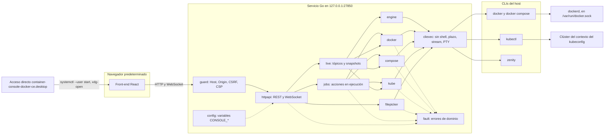
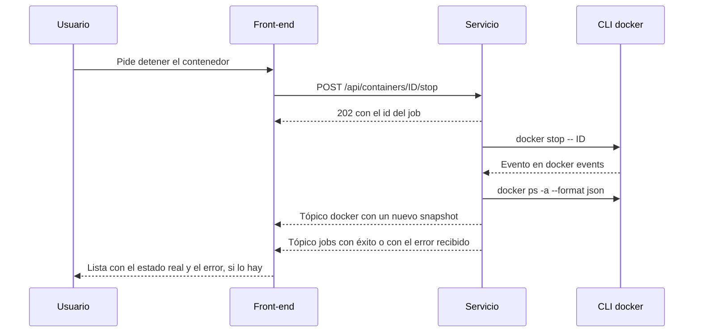
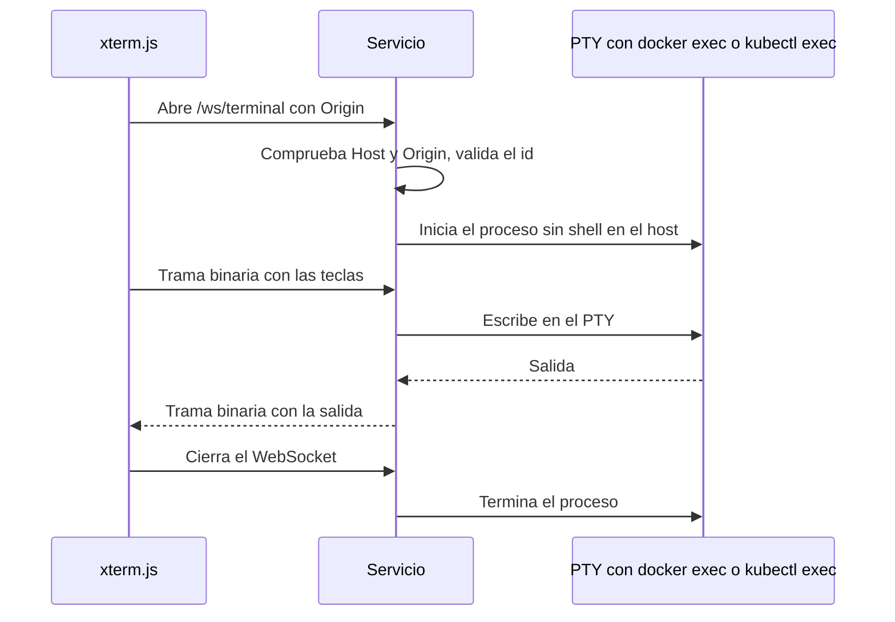
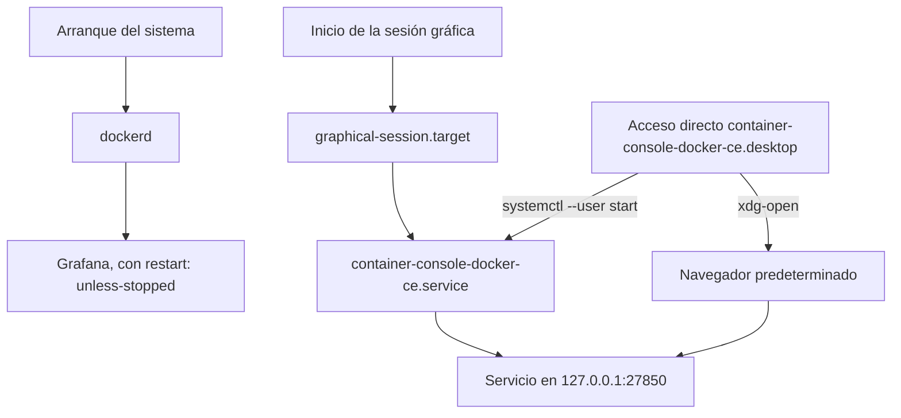

<!-- source: workspace/tools/container-console-docker-ce/docs/architecture.md sha256:01350b28a4de49bcd819b9bf5e5ca58837c683cd0394065f98cc5fd12fb9a5d3 -->

# Arquitectura de `container-console-docker-ce`

- [Vista de conjunto](#vista-de-conjunto)
- [Módulos del servicio](#módulos-del-servicio)
- [Flujo de una acción](#flujo-de-una-acción)
- [Sesión y acceso directo](#sesión-y-acceso-directo)
- [Front-end](#front-end)
- [Límites y decisiones de diseño](#límites-y-decisiones-de-diseño)

Explicación del diseño. Las rutas están en [api.md](api.md).

## Vista de conjunto

El servicio se ejecuta como usuario común, bajo `systemd --user`, y habla con Docker mediante el grupo `docker`. Por eso solo lee el estado del daemon: encenderlo y apagarlo requiere root, y la consola solo muestra el comando. Cada sistema externo tiene un módulo dueño, y todos hablan con la CLI mediante el mismo ejecutor.

## Módulos del servicio

| Módulo | Responsabilidad |
| --- | --- |
| `cmd/container-console-docker-ce` | Lee la configuración, abre el log, conecta los módulos, escucha en `127.0.0.1` y termina con `SIGINT` o `SIGTERM` |
| `internal/config` | Lee las variables `CONSOLE_*`, las valida y rechaza cualquier dirección que no sea `127.0.0.1` |
| `internal/cliexec` | Ejecuta `docker`, `kubectl` y `zenity` sin shell, con plazo, salida en stream y PTY |
| `internal/fault` | Error de dominio con clase, código estable y parámetros, sin tipo de transporte |
| `internal/jobs` | Registra cada acción (hasta 50 terminadas, 200 líneas de salida cada una) |
| `internal/live` | Hub de los tópicos `environment`, `docker`, `kubernetes` y `jobs`: snapshot completo al suscribirse y en cada cambio |
| `internal/engine` | Estado y datos del daemon, leídos de `docker info`: encendido, apagado o desconocido, versión, CPUs, memoria, driver, sistema operativo y arquitectura |
| `internal/docker` | Contenedores, imágenes, volúmenes, redes, uso de recursos, eventos y limpieza |
| `internal/compose` | Proyectos Compose, incluida la lista de los conocidos, guardada en `compose-projects.json` |
| `internal/kube` | Namespaces, pods, deployments y services del contexto actual del kubeconfig o de `CONSOLE_KUBE_CONTEXT`; escalar, eliminar y aplicar YAML |
| `internal/filepicker` | Diálogo de selección de archivo del escritorio, mediante `zenity`. El código de salida 1 es una cancelación, salvo cuando `zenity` dice que no pudo abrir el display |
| `internal/httpapi` | `guard`, rutas REST, validación de entrada, puentes WebSocket de tópicos, logs y terminal |
| `internal/webui` | Incrusta el front-end generado en `internal/webui/dist` |

## Flujo de una acción

Toda mutación es un job: la pantalla nunca espera una petición HTTP larga, y el error siempre llega por el mismo camino. Una fila solo cambia con el snapshot, nunca de forma optimista.

La terminal y los logs usan un WebSocket con el proceso en el host. Cerrar el WebSocket termina el proceso, y el contenido de la terminal nunca va al log.

## Sesión y acceso directo

- La consola no arranca Docker ni Grafana. `dockerd` pertenece al sistema, y Grafana vuelve solo con él.
- La unit parte de `graphical-session.target` porque `zenity` necesita las variables de display que exporta la sesión. Antes de eso, el diálogo de archivo fallaría.
- `Restart=on-failure` vuelve a arrancar un proceso que falló. `KillMode=process` no envía señales a las CLIs en curso cuando el servicio se reinicia, pero no garantiza que terminen: el job se pierde, y la siguiente escritura de salida encuentra el pipe cerrado.
- El acceso directo es un archivo `.desktop` con el ícono `favicon.png` copiado sin cambios, por ruta absoluta, porque no es cuadrado y nunca se redimensiona.

## Front-end

React, Vite y TypeScript, incrustado en el binario. Sin bibliotecas de rutas, estado, CSS ni componentes: `fetch`, `<dialog>` nativo, rutas por hash y CSS Modules con variables CSS. Cada área es una carpeta en `web/src/features/<nombre>/` (`route.tsx`, `messages.en.ts` y `messages.pt-BR.ts`), que `App.tsx` descubre solo. Los textos viven en diccionarios, con frases completas y parámetros con nombre; el `code` de error de la API es la clave de la traducción. Los logs y la terminal usan xterm.js.

Idioma: el inglés es el predeterminado. `web/src/i18n/index.ts` elige el portugués de Brasil cuando `navigator.language` empieza con `pt`, y cada diccionario (`web/src/i18n/{messages,errors,jobs}.<locale>.ts` y los `messages.<locale>.ts` de las áreas) tiene las mismas claves en ambos idiomas, comprobadas por el compilador.

Tema:

- Cada token de `web/src/styles/semantic.css` declara los dos valores con `light-dark()`, y el `color-scheme` de la raíz elige el lado. Sin una elección guardada, decide el sistema operativo, incluso si cambia con la pantalla abierta, sin JavaScript.
- El campo `Theme` (`components/ThemeSelect.tsx`) guarda `container-console-docker-ce.theme` en `localStorage` y define `data-theme` en la raíz. Con "Follow the system", el atributo se quita.
- `web/public/theme-init.js` aplica la elección guardada antes del primer pintado. Es un script clásico y externo en `<head>`, porque un módulo se ejecuta demasiado tarde y la CSP `script-src 'self'` rechaza scripts inline.
- `build.cssTarget`, en `vite.config.ts`, empieza en los primeros navegadores con `light-dark()` (Chrome 123, Safari 17.5, Firefox 120). Con el objetivo predeterminado, Vite compilaría los tokens a un sustituto con variables.
- La barra superior, el menú lateral y el cajón quedan sobre `ink` en ambos temas, con `logo-compact-on-dark.png`. Los logs y la terminal también mantienen un único fondo oscuro: xterm lee los colores una vez y no entiende `light-dark()`.
- `--color-primary` es solo relleno, bajo `--color-primary-foreground`. El texto y las partes finas usan `--color-primary-on-surface`, porque `#0076a3` sobre `#303841` da 2,33:1. En oscuro, el botón primario recibe un borde `brand-accent-dark`, que da 4,89:1 sobre la tarjeta.

Identidad ([`rules/frontend.md`](../../../../../../workspace/rules/frontend.md)): la identidad es la del proyecto Claude CLI Agents Workspace: el ícono (`web/public/favicon.png`, recortado del logo en `assets/` de la raíz), el nombre del proyecto y el de la herramienta en la barra superior, y la paleta de `web/src/styles/brand.css`, tomada del logo; Roboto para el texto y Poppins 700 para los títulos, mediante `@fontsource` 5.3.0, solo el subconjunto `latin`, que cubre inglés, portugués y español; un carácter fuera de él usa la fuente del sistema. Los títulos usan `--font-heading` y `--font-heading-weight`, para cambiarlos en un solo lugar. Esquinas de 5 px en controles y 20 px en tarjetas.

Contraste calculado con un script, sin abrir la pantalla. Mínimo de 4,5:1 para texto y 3:1 para partes de la interfaz. Los pares exigidos más bajos:

| Par | Medido | Mínimo |
| --- | --- | --- |
| Ícono de la insignia `good`: blanco sobre `#1d9b7b` | 3,48:1 | 3:1 |
| Ícono de la insignia `serious`: `ink` sobre `#e46e2a` | 3,65:1 | 3:1 |
| Anillo de foco y barra sobre `muted`, oscuro | 3,88:1 | 3:1 |
| Anillo de foco sobre `muted`, en `ink` | 3,75:1 | 3:1 |
| Anillo de foco y barra sobre `muted`, claro | 4,30:1 | 3:1 |
| Ícono de la insignia `critical`: blanco sobre `#da3746` | 4,55:1 | 3:1 |
| Ícono de error de campo, `#da3746` sobre blanco | 4,55:1 | 3:1 |
| Texto seleccionado en la terminal, `#f8f9fc` sobre `#0076a3` | 4,84:1 | 4,5:1 |
| Enlace sobre la tarjeta oscura, `#24bee6` sobre `#343f4b` | 4,89:1 | 4,5:1 |
| Texto blanco sobre el botón primario | 5,10:1 | 4,5:1 |
| Elemento activo del menú: `ink` sobre `#24bee6` | 5,33:1 | 4,5:1 |
| Enlace sobre `muted`, claro: `--color-link-on-muted` | 5,31:1 | 4,5:1 |

El enlace común sobre `muted` quedaría en 4,30:1 en claro y 3,88:1 en oscuro, por eso `--color-link-on-muted` se aplica en avisos, filas de tabla con hover y la pestaña actual con hover. `#da3746` sobre la tarjeta oscura daría 2,36:1, por eso el ícono de error de campo usa `--color-status-critical-on-surface`, el color del texto, en oscuro.

Por debajo de 3:1, sin transmitir información por sí solo: el relleno de la insignia sobre su fondo. Claro: `good` 2,94, `warning` 1,48, `serious` 2,70. Oscuro: `good` 2,44, `serious` 2,65, `critical` 1,87. Sobre `ink`: `good` 2,36, `serious` 2,57, `critical` 1,81. El estado lo indican el ícono, medido contra el relleno, y el texto de al lado, nunca el borde del relleno.

## Límites y decisiones de diseño

- El nombre del módulo Go es `container-console-docker-ce`, sin dominio: la herramienta es su propio módulo principal, y nada lo importa.
- Un YAML que crea un namespace y recursos dentro de él se rechaza en el ensayo; aplique el namespace primero.
- El logo y el ícono son PNG, porque no hay un SVG oficial de la marca.
- Sin diff de estado: cada snapshot es completo, lo que alcanza para hasta 30 contenedores.
- Dependencias Go externas: `coder/websocket` y `creack/pty`. Versiones en `go.mod`.
