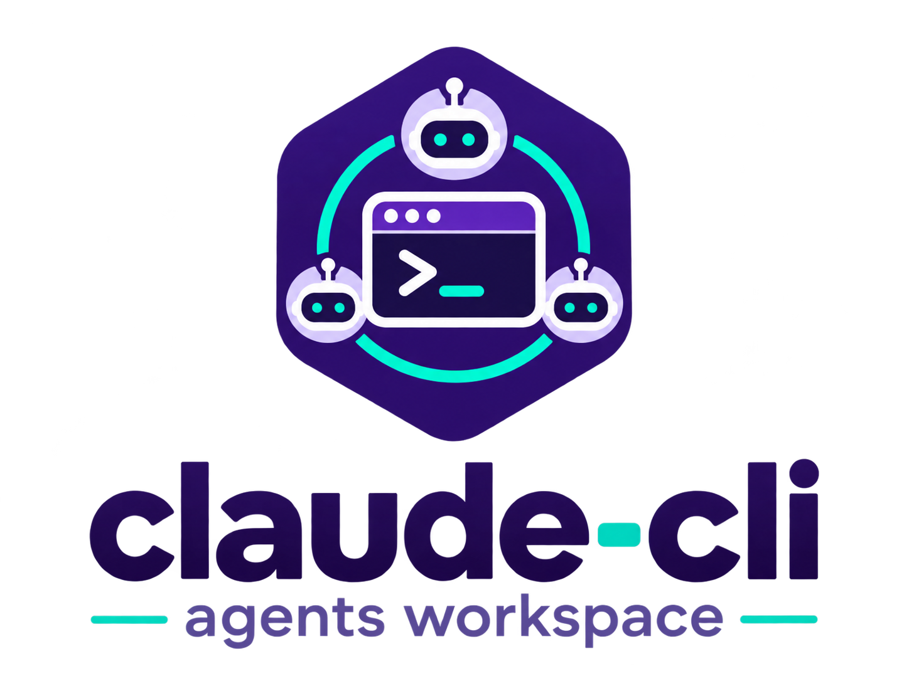

<!-- source: workspace/README.md sha256:0178760f9c2d955a0551dbd9aaf55452c4756f4c52a6cc0a431c3300fbe6b6d0 -->

# Claude CLI Agents Workspace

<p align="center"></p>

Um workspace para desenvolver com o **Claude Code CLI**: você diz **o que** quer, e o Claude decide **como**, trabalhando num clone isolado onde tudo é livre. A verificação pesada e as perguntas para você ficam num lugar só: o gate que leva o trabalho para a base do projeto.

> **Feito para a CLI.** Hooks, permissões, skills e o nome das sessões foram desenhados e testados no Claude Code de terminal (`claude`). O app do Claude (desktop ou web) e as extensões de IDE provavelmente conseguem abrir o workspace, mas podem tratar hooks, permissões e comandos de outro jeito; ali, o que este README descreve não é garantido.

## Faça parte

Este workspace nasceu do uso diário: de errar, medir e simplificar. Ele fica melhor a cada pessoa que o usa num projeto de verdade.

Encontrou um jeito melhor de fazer algo? Corrigiu um defeito? Escreveu um hook que poupa perguntas, uma regra mais clara, uma ferramenta útil? **Compartilhe** com um pull request para o repositório do produto (o README dele explica como).

- **Bug ou ideia:** abra uma issue com o que aconteceu, o que você esperava e como reproduzir.
- **O que é seu fica com você:** empresa, projetos, identidade visual e pedidos ficam na sua camada custom (`custom/`), nunca num pull request.
- **Regra nova:** prefira um hook ou um script testado a mais texto, e diga o que a mudança acrescenta ou tira de toda sessão (um passo, uma pergunta, texto carregado).

## Quick start

Do zero até o primeiro trabalho mesclado, em seis passos.

**Do que você precisa:**

- **Linux.** No Windows, só pelo **WSL2**: instale uma distribuição Linux (Ubuntu, por exemplo) e faça tudo de dentro dela, com a mesma estrutura do Linux. O workspace, os projetos, o Docker e o `claude` ficam no sistema de arquivos do WSL (`~/...`), nunca em `/mnt/c`. Não há versão nativa para Windows.
- O Claude Code CLI instalado e com login feito: `claude` abre uma sessão.
- `git`, Docker Engine, `bash` e `python3`.
- **Opcional, mas muito importante: a stack de observabilidade** (`tools/observability/`, um Grafana local em <http://localhost:3000>). O workspace funciona sem ela, mas é ela que mostra o que cada sessão custa, em tokens, tempo e modelo, e `scripts/performance/measure.py` só mede com ela no ar. Sem medição, não há como saber se uma mudança nas regras melhorou ou piorou o trabalho. Suba uma vez e siga o README dela para ligar a telemetria do Claude Code.
- **Recomendado: o [Claude in Chrome](https://claude.com/chrome)**, a extensão que deixa o Claude abrir páginas no seu Chrome, clicar, ler o console e tirar capturas de tela. Com ela, o Claude valida layouts e fluxos de tela sozinho, como uma pessoa faria à mão (`/pilot auto`). Instale a extensão no Chrome e conecte-a na sessão com `/chrome` ([como usar](https://code.claude.com/docs/en/chrome)). Ela não funciona no WSL: no Windows, esses testes ficam com você (`/pilot manual`).

### 1. Crie o seu workspace

O instalador do repositório do produto (o README dele) instala o comando `aiwp` e cria o seu workspace: ele pergunta a pasta, que precisa ser nova ou vazia (ou a recebe como argumento ou em `AIWP_WORKSPACE`). Para criar outro:

```bash
aiwp new ~/my-workspace
cd ~/my-workspace
```

O core do workspace é só leitura, e a raiz do workspace não é um repositório git: `custom/` e cada projeto são os repositórios. Todo workspace está no registro da pasta de dados (`aiwp list`; `aiwp forget <pasta>` tira uma entrada e nunca toca na pasta). As releases novas chegam só por comando: o `aiwp update`, num terminal sem sessão aberta, lista os workspaces registrados e pergunta se atualiza todos, escolhe quais ou cancela; ele troca só os arquivos do core que mudaram, e o seu `custom/`, `projects/` e `tmp/` nunca são tocados. O `aiwp` só avisa quando há release nova. Quando uma sessão começa e há uma release nova, o Claude avisa; feche a sessão e rode `aiwp update` num terminal (o Claude nunca o roda: ele muda as regras da sessão aberta).

Para remover um workspace, devolva antes a permissão de escrita, já que o core é só leitura: `chmod -R u+w <folder> && rm -rf <folder>`. A sua camada custom e os seus projetos vão junto: faça push deles antes.

### 2. Ligue a sua camada custom

A camada custom é um **repositório privado e seu**, que guarda o que não é de mais ninguém: a sua empresa, a nuvem e o tenant, a identidade visual, a lista dos seus projetos, os pedidos escritos, as lições, o backlog, as suas próprias ferramentas (`custom/tools/`) e os arquivos `.env` preenchidos (`custom/env/`, nunca commitados). Crie um repositório vazio no seu servidor git: o `aiwp new` pede a URL dele (ou a recebe com `--custom <url>`) e o clona em `custom/`; um repositório vazio ganha um esqueleto e um primeiro commit.

Quer só experimentar? Deixe a URL vazia: o `aiwp new` cria um repositório local com o esqueleto, e você pode dar um remoto depois (`git -C custom remote add origin <url>`). O que vai na camada está em `rules/rules.md`, seção "Custom layer".

### 3. Traga um projeto

Um projeto que já existe, na sessão (passo 4): `/normalize-projects --from <url of your project or its folder> --name my-app`. Ele clona o projeto em `projects/my-app` e o normaliza (como funciona: [docs/usage.md](docs/usage.md), "Projetos"). Um projeto que você clona à mão, ou uma POC que você move para `custom/pocs/`, também serve: a sessão avisa que ainda não é um projeto do workspace e pede para normalizar.

A `developer` é a base de trabalho; a normalização a cria quando o remoto não tem, depois de perguntar. Projeto novo: `bash scripts/init-repo.sh --type project --name my-app`, já marcado como projeto do workspace.

### 4. Abra a sessão na raiz

```bash
aiwp
```

O `aiwp` confere se há release nova (nunca atualiza), roda o `scripts/setup-claude.sh` e inicia o `claude`; os argumentos para o `claude` vão depois de `--`.

Sempre na raiz do workspace, mesmo para trabalhar num projeto: é ali que as regras e os hooks valem. Recomendado: o auto mode do Claude Code. O workspace deixa para ele o julgamento do que é destrutivo e guarda nos hooks só o que nunca pode acontecer. O Claude responde na língua em que você escreve.

### 5. Peça

```text
no my-app, cria um endpoint GET /health que responde 200 com a versão da aplicação
```

O Claude pergunta só o que impede de começar e abre um clone em `tmp/work/<date>-<subject>/my-app/`. Ele diz o caminho e trabalha só ali, com testes. Cada commit vai sozinho para o remoto, depois de uma varredura de segredos.

### 6. Leve para a base

```text
/merge <date>-<subject>/my-app
```

O gate traz a `developer` atualizada, roda a suíte inteira e as validações, procura segredos, mostra o que sai da base e pede uma revisão contra o seu pedido. Você só é perguntado se aparecer algo que o pedido não explica. Depois, a `developer` avança exatamente para o commit que passou.

**Depois:** para pedidos maiores, monte o pedido com `/draft-prompt` e rode com `/prompt`; a sessão ganha o nome do projeto, numerado (`my-app-1`, `my-app-2`...). O guia completo está em [docs/usage.md](docs/usage.md).

## Como funciona

1. **Pergunta ou leitura:** o Claude responde; nada é aberto.
2. **Mudança num projeto ou numa POC:** um clone em `tmp/work/` (`bash scripts/aiwp-cmds.sh open`). Lá dentro, commit, rebase, reset e Docker são livres, e a branch está sempre no remoto: um hook não deixa a resposta terminar com commit só na máquina.
3. **Base:** `/merge` passa pelo gate, em duas fases (verificação, revisão contra o pedido, merge do commit verificado).
4. **Ondas:** num plano em etapas, cada etapa fecha com commit, um pedido de retomada em `custom/prompts/` e um quadro do que foi feito e do que falta. A próxima etapa começa numa sessão nova.

## O que nunca acontece sem você

- **`projects/` fica na `developer` e só muda pelo gate.** Um hook recusa qualquer escrita git em `projects/` ou no core fora dele.
- **`main` e nuvem só a seu pedido.** A `main` só anda com `bash scripts/aiwp-cmds.sh release`, e o Terraform só aplica com `bash scripts/aiwp-cmds.sh apply`, a partir da `main` e com o plano confirmado.
- **Apagar banco de dados pede a sua confirmação**: volume do Docker, `DROP`, `dropdb` e afins.
- **Publicar no Docker local é livre**, e `bash scripts/aiwp-cmds.sh up` sempre marca antes a publicação anterior; `rollback` volta para ela.
- **Segredo não sai da máquina:** a varredura roda antes de cada push e de novo no gate.
- **A sessão não altera o workspace:** regras, scripts, hooks e ferramentas são só leitura e só mudam com uma release nova. O `guard-bash` recusa um `chmod`, `chown` ou `git init` que alcance o core, e `aiwp update`, `rollback`, `repair`, `forget` e a abertura dentro de uma sessão.
- **O resto segue o modo de permissão do Claude Code.**

Os hooks: `scripts/guard-bash.sh` (git, Terraform, banco, segredo, o core só de leitura; `--help` lista tudo), `scripts/release-notice.sh` (no início da sessão, avisa quando há release nova), `scripts/guard-subagent-model.sh` (o modelo de cada subagente), o hook `Stop` de `scripts/aiwp-cmds.sh` (commit fora do remoto), `scripts/session-title.py` (o nome da sessão, e o aviso sobre um projeto citado na mensagem que não tem marcador ou está desatualizado) e `scripts/prompt-log.py` (o registro dos prompts; no início da sessão, o resumo do último dia). O desenho: [docs/decisions/0001-base-design.md](../../../workspace/docs/decisions/0001-base-design.md).

## Comandos

| Comando | Faz |
| --- | --- |
| `/merge <work>/<clone>` | Leva o trabalho de um clone para a `developer` do projeto, pelo gate |
| `/commit [--all] [--repo <dir>]` | Um commit por mudança lógica, num clone ou no `custom/` |
| `/push [--repo custom \| <work>/<clone>]` | Envia o `custom/`, ou reenvia um clone cujo push automático falhou |
| `/validate [folder] [--only <checks>] [--sonar]` | Roda as validações em Docker e, opcionalmente, o SonarQube |
| `/draft-prompt [ideas \| file]` | Transforma as suas ideias num pedido do tamanho certo (ajuste, funcionalidade ou sistema), com o effort de cada etapa; pergunta só o que bloqueia e salva em `custom/prompts/` |
| `/prompt [name \| path]` | Executa um pedido escrito, dá à sessão o nome do projeto, numerado, e arquiva o pedido quando ele é entregue |
| `/pilot [auto\|manual]` | Mostra ou troca quem faz os testes que um humano faria à mão: o Claude (`auto`, o padrão) ou você (`manual`) |
| `/local-env [folder]` | Cria ou completa o `.env` preenchido a partir do `.env.example`, sem mostrar valores: para `docker/`, `docker/sonar/` e uma ferramenta de `tools/`, em `custom/env/<name>.env` |
| `/normalize-projects [<project>... \| --from <url \| folder> [--name <path>]]` | Lista o estado de cada projeto e POC; ou analisa um (quatro analistas, um plano que você aprova, o idioma da documentação dele) e o migra numa branch testada, com tags de checkpoint, para a `developer` e a `main` |

A área de trabalho tem o seu próprio comando: `bash scripts/aiwp-cmds.sh --help` (`open`, `run`, `status`, `push`, `close`, `up`, `rollback`, `gate`, `release`, `apply`, e `developer`, `checkpoint`, `bring` para a normalização). Os comandos do próprio Claude Code continuam valendo: `/rewind`, `/rename`, `/usage`.

## Modo single-agent

Para trabalhar num projeto, numa ferramenta sua em `custom/tools/` ou numa POC de `custom/pocs/` sem as instruções, os hooks e as skills do workspace: `single-claude [<path>] [--commit] [--merge] [--review]`, instalado uma vez com `ln -sf "<workspace>/scripts/single-claude.sh" ~/.local/bin/single-claude`. Guia: [docs/single-agent.md](docs/single-agent.md).

## Projeto de prompts

Para escrever pedidos fora da sessão de desenvolvimento, crie um projeto no Claude só para isso: cole nas instruções dele tudo o que está abaixo do marcador `<!-- paste below -->` de `rules/prompt-project.md` e conecte a pasta do workspace como referência. O `/draft-prompt` segue o mesmo arquivo dentro do workspace.

## Ambiente local

- Validação em Docker: `bash scripts/validate.sh --help`. SonarQube, opcional: `bash scripts/sonar.sh --help`.
- Medição de desempenho do workspace: `python3 -I -B scripts/performance/measure.py --name <name>` (com a observabilidade no ar) grava `custom/performance/<date>-<name>.md`, comparando com a medição anterior e com as últimas cinco.
- Tarefas pesadas de CPU ou GPU (gráficos, renderização 3D) passam por `bash scripts/heavy-run.sh`, que espera a máquina esfriar; testes e builds rodam direto.
- Ferramentas em `tools/`: o Grafana local para a telemetria do Claude Code (`tools/observability/`, em <http://localhost:3000>), os consoles de contêineres, os simuladores de login e de Safe Browsing, o console do Azurite, o relatório de uso e o alerta de Fable. Cada uma tem o seu README ([tools/README.md](tools/README.md)); as que aceitam configurações leem `custom/env/<name>.env` (`/local-env tools/<name>`). As suas próprias ferramentas ficam em `custom/tools/` (`bash scripts/init-repo.sh --type tool`).

## Estrutura

- `AGENTS.md`: ponto de entrada do Claude (carregado pelo `CLAUDE.md`). O que vale em toda sessão, em uma página.
- `rules/`: regras por assunto, os subagentes (`rules/agents/`), os comandos (`rules/skills/`) e a configuração de hooks e permissões (`rules/agents/settings.json`).
- `scripts/`: a área de trabalho, o gate, os hooks, a validação e a criação de repositórios (catálogo em [scripts/README.md](scripts/README.md)).
- `docker/`: ferramentas de validação em contêiner.
- `docs/`: guia de uso, visão geral e registros de decisão.
- `assets/`: o logo do projeto (`logo.png`, `logo-white.png`) e o ícone recortado dele (`icon.png`).
- `tools/`: as ferramentas locais do produto, parte do core.
- `templates/`: os formulários que você copia e preenche: um pedido funcional (`templates/request.md`) e um item de backlog (`templates/backlog-item.md`).
- `VERSION` e `CHANGELOG.md`: a release instalada e o que cada release mudou.
- `projects/`: um repositório git independente por projeto, nunca parte do core.
- `custom/`: a sua camada custom, um repositório git próprio, com as suas ferramentas em `custom/tools/` e os arquivos `.env` preenchidos em `custom/env/` (ignorados pelo git). As medições de desempenho ficam em `custom/performance/`, o registro dos prompts, por projeto e por semana, em `custom/prompts/log/` (`scripts/prompt-log.py`), e o backlog em `custom/backlog/`.
- `tmp/work/`: os clones de trabalho, um por pedido, fora do git.
