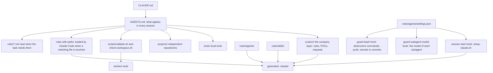

<!-- source: workspace/docs/overview.md sha256:75d5f6a5ce6b9832ebf9c5a5588c2a8c869a6cfee398b6f86823922383acdd5a -->

# Visão geral

O Claude CLI Agents Workspace orienta o Claude Code nas sessões de desenvolvimento. O humano define **o que** fazer; o Claude decide **como**. Uso do dia a dia: [usage.md](usage.md).

## Como as peças se ligam

## Princípios

| Princípio | Como aparece |
| --- | --- |
| Liberdade no trabalho, rigor no merge | O trabalho acontece num clone em `tmp/work/`, sem perguntas; o gate (`/merge`) é o único caminho para `projects/`, com a verificação pesada e as perguntas ao humano |
| Uma sessão por pedido | A revisão é um subagente de contexto limpo dentro do gate; nenhuma sessão espera outra |
| Garantia em mecanismo | O que não pode acontecer está num hook, numa permissão ou no `aiwp-cmds.sh`, não em texto; o resto segue o modo de permissão do Claude Code |
| Um registro por fato | O commit registra o pedido; registro de decisão só para o que é difícil de reverter |
| Regras curtas | `AGENTS.md` cabe em uma página; uma regra de assunto só carrega quando um arquivo do tipo dela é tocado |

O desenho base e os motivos: [decisão 0001](../../../../workspace/docs/decisions/0001-base-design.md).

## O que cada parte faz

- **`AGENTS.md`**: papel, ambiente local, onde o trabalho acontece, a definição de pronto, a segurança e o que fazer quando uma regra atrapalha.
- **Regras por caminho** (`quality`, `security`, `frontend`, `infra`, `docs`, `scripts`): têm `paths:` no topo; o `setup-claude.sh` as copia para `.claude/rules/`, e o Claude Code as carrega quando um arquivo que casa é lido ou editado.
- **Regras de consulta** (`git`, `review`, `models`, `rules`, `machine-load`): lidas quando a tarefa pede.
- **`scripts/aiwp-cmds.sh`**: a área de trabalho (clones em `tmp/work/`, push automático com varredura de segredos, publicação no Docker local com rollback) e o gate (`aiwp-gate.sh`: merge, release e Terraform apply).
- **Hooks**: `guard-bash` (git em `projects/` e no core, Terraform, banco de dados, segredos nos commits do `custom/`), `guard-subagent-model` (o modelo de cada subagente), o hook `Stop` (commit fora do remoto) e o hook de início de sessão, que mantém a `.claude/` em dia. Regras `deny` deixam o core e `projects/` só de leitura.
- **Validação**: `scripts/validate.sh` roda as ferramentas de `docker/compose.yaml`; `scripts/check-workspace.sh` é o gate do repositório do produto.
- **Subagentes**: onze, com modelo fixo por papel (`rules/models.md`). O padrão é um agente só; o `reviewer` entra no gate.

## Como o workspace evolui

- **O core é só leitura.** Num workspace instalado, regras, hooks, scripts e ferramentas só mudam por uma atualização vinda de uma release nova. Uma sessão nunca os edita: ela anota a proposta em `custom/docs/lessons.md`.
- **Mudar o produto:** por um pull request para o repositório do produto, mantido a partir da raiz dele, onde as regras do próprio produto são código em edição e nunca instrução.
- **Lições:** vão para `custom/docs/lessons.md`, que não é carregado nas sessões. Você revê a lista e decide o que vira hook, o que vira uma frase numa regra e o que é apagado. Nenhuma lição vira regra sozinha.
- **Regra sem exceção** vira hook ou permissão. **Preferência** fica como frase curta, sem `MUST` nem `NEVER`.
- **As suas próprias regras:** `custom/rules/*.md` chegam a toda sessão, carregadas como as regras do core; o core obrigatório continua valendo.
- **Registro de decisão:** só para escolha difícil de reverter, com a linha `Status:`. O índice é o [decisions/README.md](../../../../workspace/docs/decisions/README.md).
- **Medir:** `scripts/performance/measure.py` lê os transcripts do Claude Code e mostra quanto de cada sessão foi processo, validação e trabalho. Rode de novo depois de mudanças grandes nas regras.

## Ambiente local

Docker Engine no Linux e leitura de temperatura antes de tarefa pesada (`rules/machine-load.md`). As exclusões de POCs estão em `custom/pocs/.gitignore`.

O que é da empresa (identidade visual, nuvem e tenant, projetos e portas, pedidos escritos, lições) fica na camada custom, `custom/`, um repositório próprio que chega à sessão pelo `setup-claude.sh`; as suas próprias ferramentas (`custom/tools/`) e os arquivos `.env` preenchidos (`custom/env/`, ignorados pelo git) também. O gate do repositório do produto, `check-workspace.sh`, falha se um termo da empresa aparecer no core.
