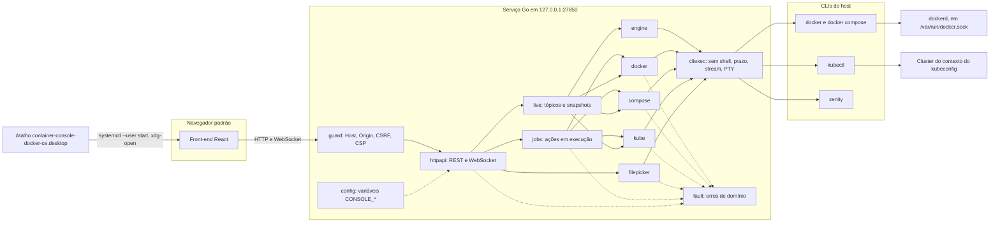
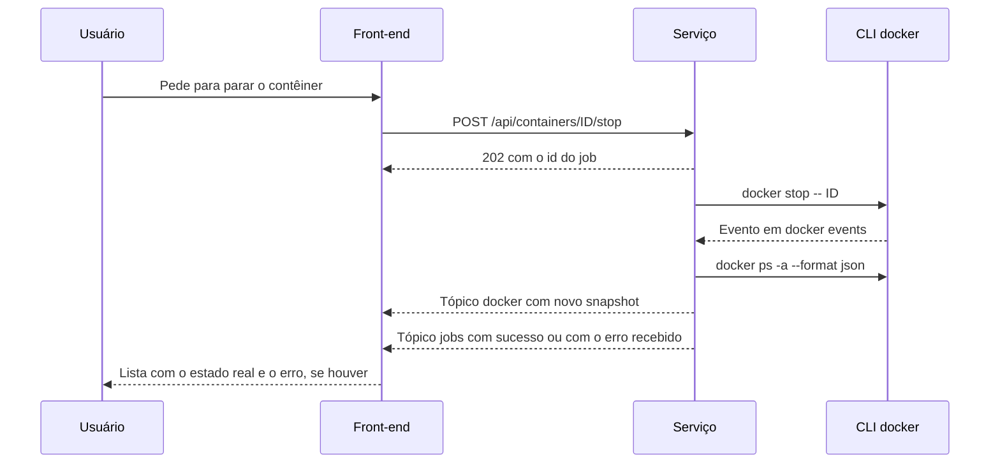
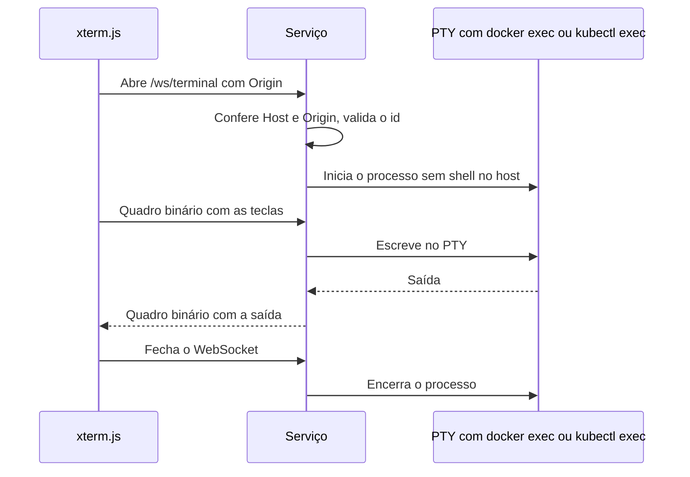
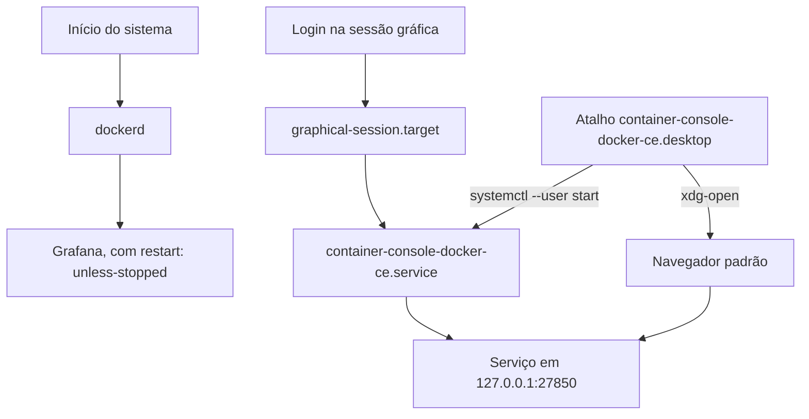

<!-- source: workspace/tools/container-console-docker-ce/docs/architecture.md sha256:01350b28a4de49bcd819b9bf5e5ca58837c683cd0394065f98cc5fd12fb9a5d3 -->

# Arquitetura do `container-console-docker-ce`

- [Visão de conjunto](#visão-de-conjunto)
- [Módulos do serviço](#módulos-do-serviço)
- [Fluxo de uma ação](#fluxo-de-uma-ação)
- [Sessão e atalho](#sessão-e-atalho)
- [Front-end](#front-end)
- [Limites e escolhas](#limites-e-escolhas)

Explicação do desenho. As rotas estão em [api.md](api.md).

## Visão de conjunto

O serviço roda como usuário comum, no `systemd --user`, e fala com o Docker pelo grupo `docker`. Por isso só lê o estado do daemon: ligar e desligar exige root, e o console só mostra o comando. Cada sistema externo tem um módulo dono, e todos falam com a CLI pelo mesmo executor.

## Módulos do serviço

| Módulo | Responsabilidade |
| --- | --- |
| `cmd/container-console-docker-ce` | Lê a configuração, abre o log, monta os módulos, ouve em `127.0.0.1` e encerra com `SIGINT` ou `SIGTERM` |
| `internal/config` | Lê as variáveis `CONSOLE_*`, valida e recusa endereço que não seja `127.0.0.1` |
| `internal/cliexec` | Executa `docker`, `kubectl` e `zenity` sem shell, com prazo, saída em stream e PTY |
| `internal/fault` | Erro de domínio com classe, código estável e parâmetros, sem tipo de transporte |
| `internal/jobs` | Registra cada ação (até 50 terminadas, 200 linhas de saída cada) |
| `internal/live` | Hub dos tópicos `environment`, `docker`, `kubernetes` e `jobs`: snapshot completo ao assinar e a cada mudança |
| `internal/engine` | Estado e dados do daemon, lidos de `docker info`: ligado, desligado ou desconhecido, versão, CPUs, memória, driver, sistema e arquitetura |
| `internal/docker` | Contêineres, imagens, volumes, redes, uso de recursos, eventos e limpeza |
| `internal/compose` | Projetos Compose, inclusive a lista dos conhecidos, guardada em `compose-projects.json` |
| `internal/kube` | Namespaces, pods, deployments e services do contexto atual do kubeconfig ou de `CONSOLE_KUBE_CONTEXT`; escalar, remover e aplicar YAML |
| `internal/filepicker` | Diálogo de escolher arquivo da área de trabalho, por `zenity`. O código de saída 1 é cancelamento, exceto quando o `zenity` diz que não abriu o display |
| `internal/httpapi` | `guard`, rotas REST, validação de entrada, pontes WebSocket de tópicos, logs e terminal |
| `internal/webui` | Embute o front-end gerado em `internal/webui/dist` |

## Fluxo de uma ação

Toda mutação é um job: a tela nunca espera um HTTP longo, e o erro chega sempre pelo mesmo caminho. A linha só muda com o snapshot, nunca de forma otimista.

Terminal e logs usam WebSocket com o processo no host. Fechar o WebSocket encerra o processo, e o conteúdo do terminal nunca vai para o log.

## Sessão e atalho

- O console não sobe o Docker nem o Grafana. O `dockerd` é do sistema, e o Grafana volta sozinho com ele.
- A unit parte de `graphical-session.target` porque o `zenity` precisa das variáveis de display que a sessão exporta. Antes disso, o diálogo de arquivo falharia.
- `Restart=on-failure` sobe de novo um processo que falhou. `KillMode=process` não envia sinal às CLIs em andamento quando o serviço reinicia, mas não garante que elas terminem: o job se perde, e a próxima escrita de saída encontra o pipe fechado.
- O atalho é um arquivo `.desktop` com o ícone `favicon.png` copiado sem alteração, por caminho absoluto, porque ele não é quadrado e nunca é redimensionado.

## Front-end

React, Vite e TypeScript, embutido no binário. Sem bibliotecas de rota, estado, CSS ou componentes: `fetch`, `<dialog>` nativo, rota por hash e CSS Modules com variáveis CSS. Cada área é uma pasta em `web/src/features/<nome>/` (`route.tsx`, `messages.en.ts` e `messages.pt-BR.ts`), que o `App.tsx` descobre sozinho. Textos em dicionários, com frases inteiras e parâmetros nomeados; o `code` de erro da API é a chave da tradução. Logs e terminal usam xterm.js.

Idioma: o inglês é o padrão. O `web/src/i18n/index.ts` escolhe o português do Brasil quando `navigator.language` começa com `pt`, e cada dicionário (`web/src/i18n/{messages,errors,jobs}.<locale>.ts` e os `messages.<locale>.ts` das áreas) tem as mesmas chaves nos dois idiomas, conferidas pelo compilador.

Tema:

- Cada token de `web/src/styles/semantic.css` declara os dois valores com `light-dark()`, e o `color-scheme` da raiz escolhe o lado. Sem escolha salva, quem decide é o sistema operacional, inclusive se ele mudar com a tela aberta, sem JavaScript.
- O campo `Tema` (`components/ThemeSelect.tsx`) grava `container-console-docker-ce.theme` no `localStorage` e define `data-theme` na raiz. Em "Seguir o sistema", o atributo sai.
- `web/public/theme-init.js` aplica a escolha salva antes da primeira pintura. É um script clássico e externo no `<head>`, porque um módulo roda tarde demais e a CSP `script-src 'self'` recusa script inline.
- `build.cssTarget`, em `vite.config.ts`, começa nos primeiros navegadores com `light-dark()` (Chrome 123, Safari 17.5, Firefox 120). Com o alvo padrão, o Vite compilaria os tokens para um substituto com variáveis.
- A barra superior, o menu lateral e a gaveta ficam sobre `ink` nos dois temas, com `logo-compact-on-dark.png`. Logs e terminal também mantêm um fundo escuro único: o xterm lê as cores uma vez e não entende `light-dark()`.
- `--color-primary` é só preenchimento, sob `--color-primary-foreground`. Texto e partes finas usam `--color-primary-on-surface`, porque `#0076a3` sobre `#303841` dá 2,33:1. No escuro, o botão primário ganha borda `brand-accent-dark`, que dá 4,89:1 sobre o cartão.

Identidade ([`rules/frontend.md`](../../../../../../workspace/rules/frontend.md)): a identidade é a do projeto Claude CLI Agents Workspace: o ícone (`web/public/favicon.png`, recortado do logo em `assets/` da raiz), o nome do projeto e o da ferramenta na barra superior, e a paleta de `web/src/styles/brand.css`, tirada do logo; Roboto no texto e Poppins 700 nos títulos, por `@fontsource` 5.3.0, só o subconjunto `latin`, que cobre inglês, português e espanhol; um caractere fora dele cai na fonte do sistema. Os títulos usam `--font-heading` e `--font-heading-weight`, para trocar em um lugar só. Cantos de 5 px em controles e 20 px em cartões.

Contraste calculado por script, sem abrir a tela. Mínimo de 4,5:1 para texto e 3:1 para partes de interface. Os pares exigidos mais baixos:

| Par | Medido | Mínimo |
| --- | --- | --- |
| Ícone do selo `good`: branco sobre `#1d9b7b` | 3,48:1 | 3:1 |
| Ícone do selo `serious`: `ink` sobre `#e46e2a` | 3,65:1 | 3:1 |
| Anel de foco e barra sobre `muted`, escuro | 3,88:1 | 3:1 |
| Anel de foco sobre `muted`, em `ink` | 3,75:1 | 3:1 |
| Anel de foco e barra sobre `muted`, claro | 4,30:1 | 3:1 |
| Ícone do selo `critical`: branco sobre `#da3746` | 4,55:1 | 3:1 |
| Ícone de erro de campo, `#da3746` sobre branco | 4,55:1 | 3:1 |
| Texto selecionado no terminal, `#f8f9fc` sobre `#0076a3` | 4,84:1 | 4,5:1 |
| Link sobre o cartão escuro, `#24bee6` sobre `#343f4b` | 4,89:1 | 4,5:1 |
| Texto branco sobre o botão primário | 5,10:1 | 4,5:1 |
| Item ativo do menu: `ink` sobre `#24bee6` | 5,33:1 | 4,5:1 |
| Link sobre `muted`, claro: `--color-link-on-muted` | 5,31:1 | 4,5:1 |

O link comum sobre `muted` ficaria em 4,30:1 no claro e 3,88:1 no escuro, por isso `--color-link-on-muted` vale em avisos, linha de tabela em hover e aba atual em hover. `#da3746` sobre o cartão escuro daria 2,36:1, por isso o ícone de erro de campo usa `--color-status-critical-on-surface`, a cor do texto, no escuro.

Abaixo de 3:1, sem carregar informação sozinho: o preenchimento do selo sobre o fundo do selo. Claro: `good` 2,94, `warning` 1,48, `serious` 2,70. Escuro: `good` 2,44, `serious` 2,65, `critical` 1,87. Sobre `ink`: `good` 2,36, `serious` 2,57, `critical` 1,81. Quem diz o estado é o ícone, medido contra o preenchimento, e o texto ao lado, nunca a borda do preenchimento.

## Limites e escolhas

- O nome do módulo Go é `container-console-docker-ce`, sem domínio: a ferramenta é o próprio módulo principal, e ninguém a importa.
- YAML que cria um namespace e recursos dentro dele é recusado no ensaio; aplique o namespace antes.
- O logo e o ícone são PNG, porque não há SVG oficial da marca.
- Sem diff de estado: cada snapshot é completo, o que cabe em até 30 contêineres.
- Dependências Go externas: `coder/websocket` e `creack/pty`. Versões em `go.mod`.
