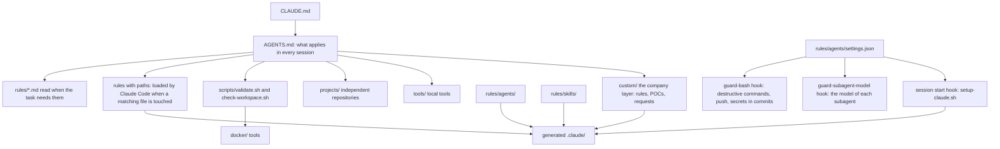

# Overview

Claude CLI Agents Workspace guides Claude Code in development sessions. The human defines **what** to do; Claude decides **how**. Day-to-day use: [usage.md](usage.md).

## How the pieces connect

## Principles

| Principle | How it shows |
| --- | --- |
| Freedom in the work, rigor at the merge | Work happens in a clone under `tmp/work/`, with no questions; the gate (`/merge`) is the only way into `projects/`, with the heavy checks and the questions to the human |
| One session per request | The review is a clean-context subagent inside the gate; no session waits for another |
| Guarantees in mechanisms | What must not happen lives in a hook, a permission or `aiwp-cmds.sh`, not in text; the rest follows Claude Code's permission mode |
| One record per fact | The commit records the request; a decision record only for what is hard to reverse |
| Short rules | `AGENTS.md` fits one page; a topic rule loads only when a file of its kind is touched |

The base design and its reasons: [decision 0001](decisions/0001-base-design.md).

## What each part does

- **`AGENTS.md`**: role, local environment, where the work happens, the Definition of Done, safety and what to do when a rule gets in the way.
- **Path rules** (`quality`, `security`, `frontend`, `infra`, `docs`, `scripts`): they carry `paths:` at the top; `setup-claude.sh` copies them to `.claude/rules/`, and Claude Code loads them when a matching file is read or edited.
- **Reference rules** (`git`, `review`, `models`, `rules`, `machine-load`): read when the task needs them.
- **`scripts/aiwp-cmds.sh`**: the work area (clones under `tmp/work/`, automatic push with a secret scan, publishing to the local Docker with a rollback) and the gate (`aiwp-gate.sh`: merge, release and Terraform apply).
- **Hooks**: `guard-bash` (git in `projects/` and in the core, Terraform, databases, secrets in the commits of `custom/`), `guard-subagent-model` (the model of each subagent), the `Stop` hook (commits not on the remote) and the session start hook, which keeps `.claude/` up to date. `deny` rules keep the core and `projects/` read only.
- **Validation**: `scripts/validate.sh` runs the tools of `docker/compose.yaml`; `scripts/check-workspace.sh` is the gate of the product repository.
- **Subagents**: eleven, with a fixed model per role (`rules/models.md`). The default is a single agent; `reviewer` joins at the gate.

## How the workspace evolves

- **The core is read only.** In an installed workspace, rules, hooks, scripts and tools change only by an update from a new release. A session never edits them: it writes the proposal in `custom/docs/lessons.md`.
- **Changing the product:** through a pull request to the product repository, maintained from its root, where the product's own rules are code being edited and never instructions.
- **Lessons:** they go to `custom/docs/lessons.md`, which is not loaded in sessions. You review the list and decide what becomes a hook, what becomes a sentence in a rule and what is deleted. No lesson becomes a rule on its own.
- **A rule with no exception** becomes a hook or a permission. **A preference** stays a short sentence, with no `MUST` or `NEVER`.
- **Your own rules:** `custom/rules/*.md` reach every session, loaded like the core rules; the mandatory core still applies.
- **Decision record:** only for a choice that is hard to reverse, with its `Status:` line. The index is [decisions/README.md](decisions/README.md).
- **Measuring:** `scripts/performance/measure.py` reads the Claude Code transcripts and shows how much of each session was process, validation and work. Run it again after large changes to the rules.

## Local environment

Docker Engine on Linux and a temperature reading before a heavy task (`rules/machine-load.md`). POC exclusions are in `custom/pocs/.gitignore`.

What belongs to the company (visual identity, cloud and tenant, projects and ports, written requests, lessons) lives in the custom layer, `custom/`, a repository of its own that reaches the session through `setup-claude.sh`; so do your own tools (`custom/tools/`) and the filled `.env` files (`custom/env/`, git-ignored). The product repository's gate, `check-workspace.sh`, fails if a company term appears in the core.
