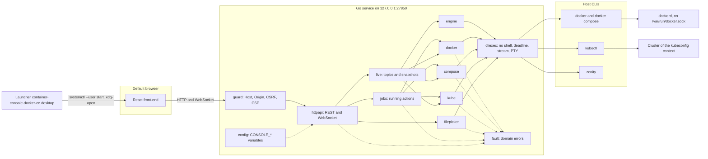
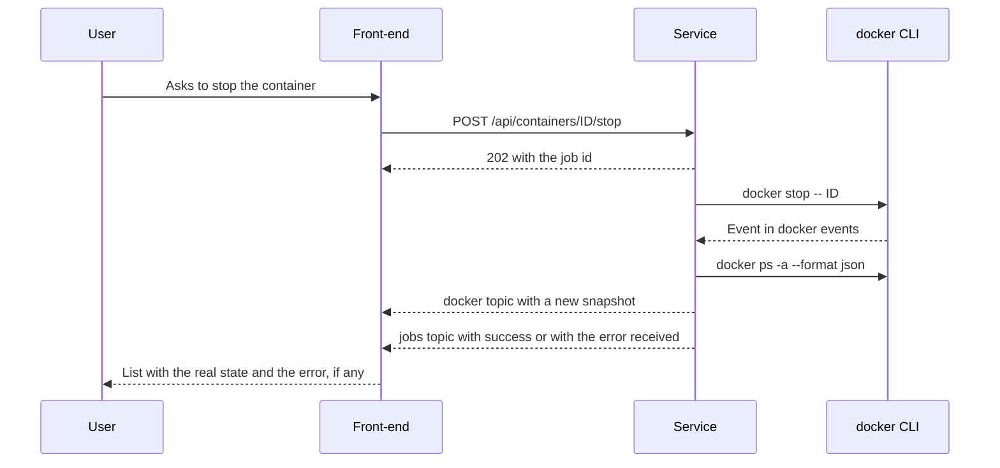
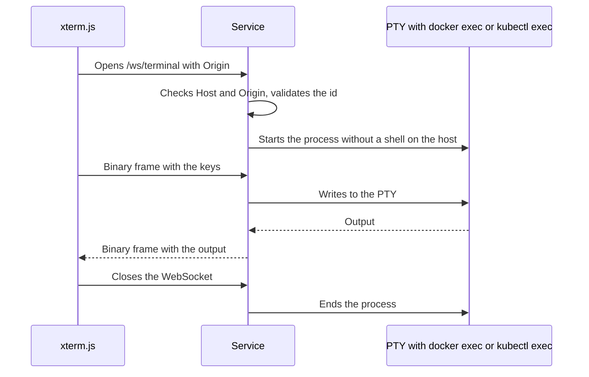
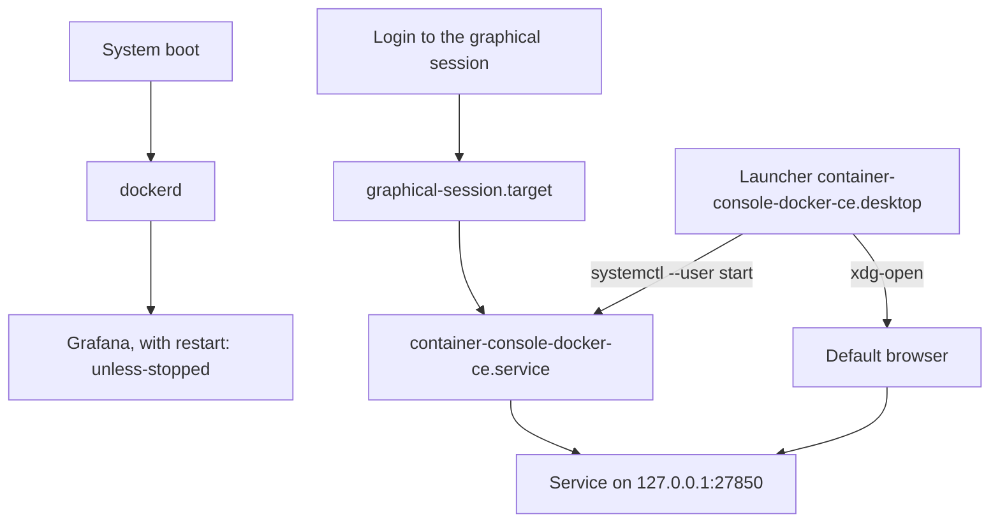

# `container-console-docker-ce` architecture

- [Big picture](#big-picture)
- [Service modules](#service-modules)
- [Flow of an action](#flow-of-an-action)
- [Session and launcher](#session-and-launcher)
- [Front-end](#front-end)
- [Limits and choices](#limits-and-choices)

Explanation of the design. The routes are in [api.md](api.md).

## Big picture

The service runs as a regular user, under `systemd --user`, and talks to Docker through the `docker` group. That is why it only reads the daemon state: starting and stopping it requires root, and the console only shows the command. Each external system has an owner module, and all of them talk to the CLI through the same executor.

## Service modules

| Module | Responsibility |
| --- | --- |
| `cmd/container-console-docker-ce` | Reads the configuration, opens the log, wires the modules, listens on `127.0.0.1` and shuts down on `SIGINT` or `SIGTERM` |
| `internal/config` | Reads the `CONSOLE_*` variables, validates them and refuses any address that is not `127.0.0.1` |
| `internal/cliexec` | Runs `docker`, `kubectl` and `zenity` without a shell, with a deadline, streamed output and PTY |
| `internal/fault` | Domain error with class, stable code and parameters, with no transport type |
| `internal/jobs` | Records each action (up to 50 finished, 200 output lines each) |
| `internal/live` | Hub of the `environment`, `docker`, `kubernetes` and `jobs` topics: full snapshot on subscribe and on every change |
| `internal/engine` | Daemon state and data, read from `docker info`: on, off or unknown, version, CPUs, memory, driver, operating system and architecture |
| `internal/docker` | Containers, images, volumes, networks, resource usage, events and cleanup |
| `internal/compose` | Compose projects, including the list of known ones, kept in `compose-projects.json` |
| `internal/kube` | Namespaces, pods, deployments and services of the current kubeconfig context or of `CONSOLE_KUBE_CONTEXT`; scale, remove and apply YAML |
| `internal/filepicker` | Desktop file-chooser dialog, through `zenity`. Exit code 1 is a cancel, except when `zenity` says it could not open the display |
| `internal/httpapi` | `guard`, REST routes, input validation, WebSocket bridges for topics, logs and terminal |
| `internal/webui` | Embeds the front-end built into `internal/webui/dist` |

## Flow of an action

Every mutation is a job: the screen never waits on a long HTTP request, and the error always arrives the same way. A row only changes with the snapshot, never optimistically.

Terminal and logs use a WebSocket with the process on the host. Closing the WebSocket ends the process, and the terminal content never goes to the log.

## Session and launcher

- The console does not start Docker or Grafana. `dockerd` belongs to the system, and Grafana comes back with it on its own.
- The unit starts from `graphical-session.target` because `zenity` needs the display variables that the session exports. Before that, the file dialog would fail.
- `Restart=on-failure` starts a failed process again. `KillMode=process` sends no signal to the CLIs in progress when the service restarts, but it does not guarantee they finish: the job is lost, and the next output write finds the pipe closed.
- The launcher is a `.desktop` file with the icon `favicon.png` copied unchanged, by absolute path, because it is not square and is never resized.

## Front-end

React, Vite and TypeScript, embedded in the binary. No routing, state, CSS or component libraries: `fetch`, native `<dialog>`, hash routing and CSS Modules with CSS variables. Each area is a folder in `web/src/features/<name>/` (`route.tsx`, `messages.en.ts` and `messages.pt-BR.ts`), which `App.tsx` discovers on its own. Texts live in dictionaries, with whole sentences and named parameters; the API error `code` is the translation key. Logs and terminal use xterm.js.

Language: English is the default. `web/src/i18n/index.ts` picks Brazilian Portuguese when `navigator.language` starts with `pt`, and every dictionary (`web/src/i18n/{messages,errors,jobs}.<locale>.ts` and the feature `messages.<locale>.ts`) has the same keys in both languages, checked by the compiler.

Theme:

- Each token of `web/src/styles/semantic.css` declares both values with `light-dark()`, and the `color-scheme` of the root picks the side. Without a saved choice, the operating system decides, even if it changes while the screen is open, without JavaScript.
- The `Theme` field (`components/ThemeSelect.tsx`) writes `container-console-docker-ce.theme` to `localStorage` and sets `data-theme` on the root. With "Follow the system", the attribute is removed.
- `web/public/theme-init.js` applies the saved choice before the first paint. It is a classic, external script in `<head>`, because a module runs too late and the CSP `script-src 'self'` refuses inline scripts.
- `build.cssTarget`, in `vite.config.ts`, starts at the first browsers with `light-dark()` (Chrome 123, Safari 17.5, Firefox 120). With the default target, Vite would compile the tokens to a fallback with variables.
- The top bar, the side menu and the drawer sit on `ink` in both themes, with `logo-compact-on-dark.png`. Logs and terminal also keep a single dark background: xterm reads the colors once and does not understand `light-dark()`.
- `--color-primary` is only a fill, under `--color-primary-foreground`. Text and thin parts use `--color-primary-on-surface`, because `#0076a3` on `#303841` gives 2.33:1. In dark mode, the primary button gets a `brand-accent-dark` border, which gives 4.89:1 on the card.

Identity ([`rules/frontend.md`](../../../rules/frontend.md)): the identity is the Claude CLI Agents Workspace project's: the icon (`web/public/favicon.png`, cropped from the logo in the root `assets/`), the project name and the tool name in the top bar, and the palette of `web/src/styles/brand.css`, taken from the logo; Roboto for text and Poppins 700 for headings, through `@fontsource` 5.3.0, only the `latin` subset, which covers English, Portuguese and Spanish; a character outside it falls back to the system font. Headings use `--font-heading` and `--font-heading-weight`, so they change in one place. Corners of 5 px on controls and 20 px on cards.

Contrast computed by script, without opening the screen. Minimum of 4.5:1 for text and 3:1 for interface parts. The lowest required pairs:

| Pair | Measured | Minimum |
| --- | --- | --- |
| Icon of the `good` badge: white on `#1d9b7b` | 3.48:1 | 3:1 |
| Icon of the `serious` badge: `ink` on `#e46e2a` | 3.65:1 | 3:1 |
| Focus ring and bar on `muted`, dark | 3.88:1 | 3:1 |
| Focus ring on `muted`, on `ink` | 3.75:1 | 3:1 |
| Focus ring and bar on `muted`, light | 4.30:1 | 3:1 |
| Icon of the `critical` badge: white on `#da3746` | 4.55:1 | 3:1 |
| Field error icon, `#da3746` on white | 4.55:1 | 3:1 |
| Selected text in the terminal, `#f8f9fc` on `#0076a3` | 4.84:1 | 4.5:1 |
| Link on the dark card, `#24bee6` on `#343f4b` | 4.89:1 | 4.5:1 |
| White text on the primary button | 5.10:1 | 4.5:1 |
| Active menu item: `ink` on `#24bee6` | 5.33:1 | 4.5:1 |
| Link on `muted`, light: `--color-link-on-muted` | 5.31:1 | 4.5:1 |

The plain link on `muted` would be 4.30:1 in light and 3.88:1 in dark, which is why `--color-link-on-muted` applies in notices, hovered table rows and the hovered current tab. `#da3746` on the dark card would give 2.36:1, which is why the field error icon uses `--color-status-critical-on-surface`, the text color, in dark mode.

Below 3:1, never carrying information alone: the badge fill against the badge background. Light: `good` 2.94, `warning` 1.48, `serious` 2.70. Dark: `good` 2.44, `serious` 2.65, `critical` 1.87. On `ink`: `good` 2.36, `serious` 2.57, `critical` 1.81. The state is told by the icon, measured against the fill, and by the text next to it, never by the edge of the fill.

## Limits and choices

- The Go module name is `container-console-docker-ce`, without a domain: the tool is its own main module, and nothing imports it.
- YAML that creates a namespace and resources inside it is refused in the dry run; apply the namespace first.
- The logo and the icon are PNG, because there is no official SVG of the brand.
- No state diff: each snapshot is complete, which fits up to 30 containers.
- External Go dependencies: `coder/websocket` and `creack/pty`. Versions in `go.mod`.
